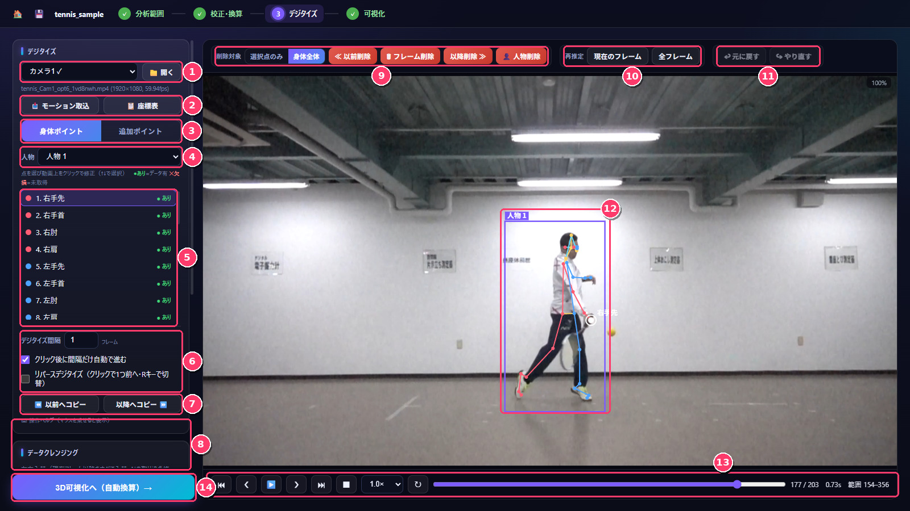
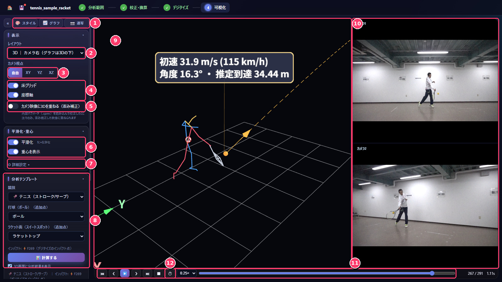

# SportsBioMechanicsAnalyzer (SBMA)

A free Windows desktop application for marker-less 2D/3D sports motion analysis from ordinary video.
From video synchronisation and camera calibration to AI pose estimation, 3D reconstruction, graphs and sport-specific measures, everything is done in one workflow.
It can also import VICON C3D files with force plates and calculate joint moments by inverse dynamics.

A description in Japanese is available on [researchmap](https://researchmap.jp/kazutaka-murata/research_blogs).

**[⬇ Download the latest version (Releases)](https://github.com/SBM-Labo/SBMA/releases/latest)**

## Screenshots

| Digitizing (pose estimation and correction) | 3D visualization and analysis templates |
|---|---|
|  |  |

The user interface is in Japanese.

## Features

| Step | Main functions |
|---|---|
| 1. Analysis range | Load videos from multiple cameras, select the analysis interval, and synchronise the cameras (frame by frame, or automatically from a clap sound) |
| 2. Calibration | 2D DLT, four-point scaling, 3D DLT, the 3D CC method using feature points on the field (2–4 cameras), and ChArUco stereo calibration. Accuracy check by RMS error and leave-one-out validation |
| 3. Digitizing | AI pose estimation (RF-DETR person detection + RTMPose, 23 body points; optional gaze from 5 face points), multi-person tracking (ByteTrack), manual correction, correction of left/right mix-ups and outliers, gap interpolation, and Butterworth smoothing (cut-off chosen by Winter's residual analysis). Additional points such as a ball can be digitized manually or tracked automatically |
| 4. Visualization | 3D stick figures (free viewpoint, trajectories, whole-body centre of mass), graphs of position, velocity, acceleration, joint angles and segment angles, and stroboscopic figures |
| Analysis templates | Ball sports (baseball, tennis, soccer, basketball, lure casting, kendama; ball speed, angle and flight distance with drag and Magnus force), jumps (CMJ / DJ / RJ: flight time, jump height, contact time, RSI), running (speed, step frequency, stride), and gymnastics vaulting (phase detection and evaluation; optional IMUs) |
| VICON / force plates (new in 1.5) | C3D import, automatic labeling and a labeling screen for Plug-in Gait markers, gap filling, force plates from C3D or CSV (including TRIAS), inverse dynamics (joint forces and moments, 14-segment Newton–Euler model), synchronised video recorded by Nexus, and IMU data |
| Export | CSV, Excel (.xlsx with editable charts), C3D, OpenSim (.trc with scaling and inverse kinematics setup files), GLB / PNG / SVG, and video of the screen (MP4) |

All processing runs on your PC. No video or data is sent to external servers, and there is no telemetry.

## Requirements

- Windows 10 / 11 (64-bit)
- 8 GB of memory or more (16 GB or more recommended for 4K video or three or more cameras)
- A DirectX 12 GPU is used automatically for pose estimation (DirectML) if available; otherwise SBMA runs on the CPU.
- About 1 GB of disk space for the application, plus space for video caches
- The user interface is in Japanese.

A macOS (Apple silicon) version will be added later.

## Installation

1. From [Releases](https://github.com/SBM-Labo/SBMA/releases/latest), download `SportsBioMechanicsAnalyzer-Setup-<version>.exe` (the installer; includes the pose estimation models).
2. Run it, accept the terms of use and install.
3. If Windows shows "Windows protected your PC", click **More info** → **Run anyway** (this appears because the application is not code-signed).

## Terms of use

This software is **free for research, educational and personal use**. For commercial use, please contact the author in advance.
Redistribution and modification are not permitted (linking to this page is welcome). See [LICENSE.txt](LICENSE.txt) for details.

Bundled third-party software and trained models are covered by their own licenses ([THIRD_PARTY_NOTICES.md](THIRD_PARTY_NOTICES.md)).
The training data of the pose estimation models (e.g., COCO) has its own terms of use. Please take care when using the software for purposes other than research and education.

## Citation

If you publish results obtained with this software, please cite it as follows ([CITATION.cff](CITATION.cff)).

> Murata, K. SportsBioMechanicsAnalyzer (SBMA) (Version 1.5.0) [Computer software]. SBM_Labo. https://github.com/SBM-Labo/SBMA

## Bug reports and contact

- Bug reports and requests: [Issues](https://github.com/SBM-Labo/SBMA/issues). Please include the output of **Help → Copy diagnostic information** (ヘルプ → 診断情報をコピー). Do not attach videos or data showing people.
- Contact: Kazutaka Murata (Faculty of Human Education, Momoyama Gakuin University), k-murata[at]andrew.ac.jp

© 2026 Kazutaka Murata (SBM_Labo)
