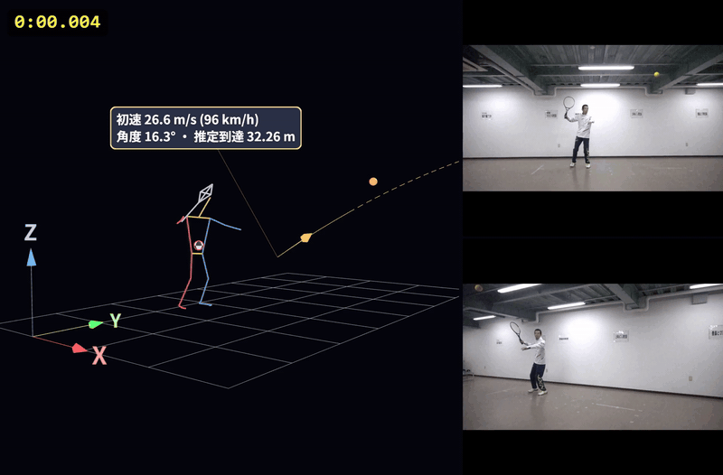

# SportsBioMechanicsAnalyzer (SBMA)

A free desktop application for Windows and macOS (Apple silicon) for marker-less 2D/3D sports motion analysis from ordinary video.
From video synchronisation and camera calibration to AI pose estimation, 3D reconstruction, graphs and sport-specific measures, everything is done in one workflow.
It can also import VICON C3D files with force plates and calculate joint moments by inverse dynamics.

A description in Japanese is available on [researchmap](https://researchmap.jp/kazutaka-murata/research_blogs).

**[⬇ Download the latest version (Releases)](https://github.com/SBM-Labo/SBMA/releases/latest)**

*Sample: a tennis stroke recorded with two cameras (right), reconstructed in 3D with the racket and the ball (left). The ball speed, launch angle and estimated flight distance are calculated by the tennis analysis template. The animation was exported from SBMA as a video (slow motion).*

## Screenshots

The user interface is in Japanese. The numbers in the screenshots are explained below each image.

### Digitizing (pose estimation and correction)

1. Camera selection and opening a video
2. Motion import (existing results in `.hpe` or MotionDigitizer `.mdp` format) and the coordinate table (can be copied to Excel)
3. Switch between body points and additional points (e.g., a ball)
4. Person selection
5. List of joints ("あり" = data available). Select a joint and click its correct position on the video to correct it.
6. Digitizing interval, automatic advance after each click, and reverse digitizing
7. Copy the current point to all earlier or all later frames
8. Data cleansing (correction of left/right swaps)
9. Delete: earlier frames, current frame, later frames, or the whole person (for the selected point or the whole body)
10. Re-estimation of the current frame or of all frames
11. Undo / redo
12. Video with the bounding box and skeleton of each person
13. Playback bar (the range on the right is given in frame numbers of the original video)
14. Go to 3D visualization (coordinates are converted automatically)

### 3D visualization and analysis templates

1. Style, graph and stroboscopic-figure panels
2. Layout of the 3D view, camera videos and graphs
3. Camera viewpoint (free, XY, YZ, XZ)
4. Floor grid and coordinate axes
5. Overlay of the 3D figure on the camera video with lens-distortion correction (for the CC method calibrated with intrinsic parameters)
6. Smoothing and display of the centre of mass
7. Detailed settings (e.g., the smoothing cut-off frequency)
8. Analysis templates (here: tennis stroke. The ball speed, angle and estimated flight distance are shown in the 3D view)
9. 3D view
10. Camera videos
11. Playback bar
12. Interval timer (stopwatch)

## Features

| Step | Main functions |
|---|---|
| 1. Analysis range | Load videos from multiple cameras, select the analysis interval, and synchronise the cameras (frame by frame, or automatically from a clap sound) |
| 2. Calibration | 2D DLT, four-point scaling, 3D DLT, the 3D CC method using feature points on the field (2–4 cameras), and ChArUco stereo calibration. Accuracy check by RMS error and leave-one-out validation |
| 3. Digitizing | AI pose estimation (RF-DETR person detection + RTMPose, 23 body points; optional gaze from 5 face points), multi-person tracking (ByteTrack), manual correction, correction of left/right mix-ups and outliers, gap interpolation, and Butterworth smoothing (cut-off chosen by Winter's residual analysis). Additional points such as a ball can be digitized manually or tracked automatically |
| 4. Visualization | 3D stick figures (free viewpoint, trajectories, whole-body centre of mass), graphs of position, velocity, acceleration, joint angles and segment angles, and stroboscopic figures |
| Analysis templates | Ball sports (baseball, tennis, soccer, basketball, lure casting, kendama; ball speed, angle and flight distance with drag and Magnus force), jumps (CMJ / DJ / RJ: flight time, jump height, contact time, RSI), running (speed, step frequency, stride), and gymnastics vaulting (phase detection and evaluation; optional IMUs) |
| VICON / force plates (new in 1.5) | C3D import, automatic labeling and a labeling screen for Plug-in Gait markers, gap filling, force plates from C3D or CSV (including TRIAS), inverse dynamics (joint forces and moments, 14-segment Newton–Euler model), synchronised video recorded by Nexus, and IMU data |
| Export | CSV, Excel (.xlsx with editable charts), C3D, OpenSim (.trc with scaling and inverse kinematics setup files), GLB / PNG / SVG, and video of the screen (MP4) |

All processing runs on your PC. No video or data is sent to external servers, and there is no telemetry.

## Requirements

- Windows 10 / 11 (64-bit), or macOS 13 Ventura or later on Apple silicon (M1 or later)
- 8 GB of memory or more (16 GB or more recommended for 4K video or three or more cameras)
- The GPU is used automatically for pose estimation if available (DirectML on Windows, Core ML on macOS); otherwise SBMA runs on the CPU.
- About 1 GB of disk space for the application, plus space for video caches
- The user interface is in Japanese.

## Installation

### Windows

1. From [Releases](https://github.com/SBM-Labo/SBMA/releases/latest), download `SportsBioMechanicsAnalyzer-Setup-<version>.exe` (the installer; includes the pose estimation models).
2. Run it, accept the terms of use and install.
3. If Windows shows "Windows protected your PC", click **More info** → **Run anyway** (this appears because the application is not code-signed).

### macOS (Apple silicon)

1. From [Releases](https://github.com/SBM-Labo/SBMA/releases/latest), download `SportsBioMechanicsAnalyzer-<version>-mac-arm64.dmg` (includes the pose estimation models).
2. Open the dmg and drag **SportsBioMechanicsAnalyzer** to the **Applications** folder.
3. Start it from the Applications folder. The application is signed and notarized by Apple; on the first start, click **Open** when macOS asks whether to open an application downloaded from the Internet.

## Terms of use

This software is **free for research, educational and personal use**. For commercial use, please contact the author in advance.
Redistribution and modification are not permitted (linking to this page is welcome). See [LICENSE.txt](LICENSE.txt) for details.

Bundled third-party software and trained models are covered by their own licenses ([THIRD_PARTY_NOTICES.md](THIRD_PARTY_NOTICES.md)).
The training data of the pose estimation models (e.g., COCO) has its own terms of use. Please take care when using the software for purposes other than research and education.

## Citation

If you publish results obtained with this software, please cite it as follows ([CITATION.cff](CITATION.cff)).

> Murata, K. (2026). *SportsBioMechanicsAnalyzer (SBMA)* (Version 1.5.0) [Computer software]. Zenodo. https://doi.org/10.5281/zenodo.23916814

Please state the version you used. The DOI above always resolves to the latest version; each version also has its own DOI, listed on the [Zenodo page](https://doi.org/10.5281/zenodo.23916814).

## Bug reports and contact

- Bug reports and requests: [Issues](https://github.com/SBM-Labo/SBMA/issues). Please include the output of **Help → Copy diagnostic information** (ヘルプ → 診断情報をコピー). Do not attach videos or data showing people.
- Contact: Kazutaka Murata (Faculty of Human Education, Momoyama Gakuin University), k-murata[at]andrew.ac.jp

© 2026 Kazutaka Murata (SBM_Labo)
